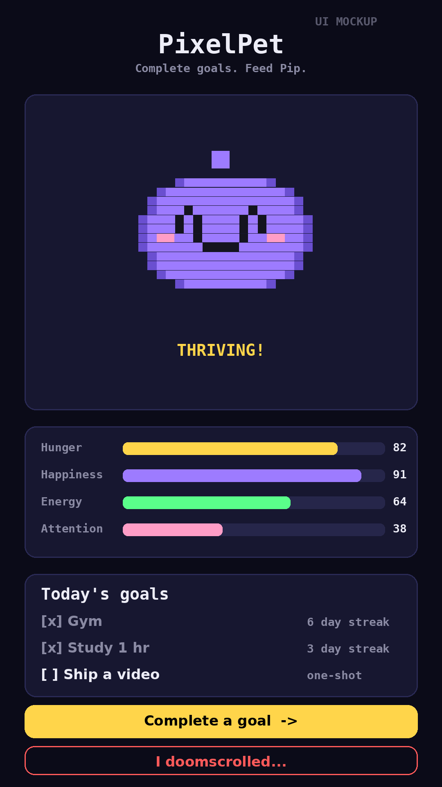

<!-- SnipeWatch — a free, private price-drop tracker that runs entirely in your browser. -->
# 🎯 SnipeWatch

**Never overpay again.** SnipeWatch tracks the products you want, watches their prices, and alerts you the moment one drops to (or below) your target price.

- ✅ **100% client-side** — no backend, no accounts, no API keys. Your watchlist never leaves your device.
- 💸 **Real price checks** — reads product pages through a free CORS proxy and parses the price from structured data (JSON-LD `offers` schema), with meta-tag and markup fallbacks.
- 📉 **Price-history charts** — hand-drawn canvas charts per product with a dashed target-price line and hover tooltips. Zero chart libraries.
- 🔔 **Drop alerts** — in-app toast + browser Notification API + a celebratory synthesized sound when a target is hit.
- ⌨️ **Manual price logging** — for sites with bot protection (Amazon, etc.), log the price yourself and the history, charts, and alerts still work perfectly.
- 🔊 **Synthesized SFX** — all sounds generated with WebAudio (zero audio files), with a persisted mute toggle.
- 🆓 **Zero budget** — free forever. Deploy to GitHub Pages as static files.

## Screenshot



*Above: generated mockup of the SnipeWatch interface (programmatically rendered preview, not a live capture). The real app matches this layout: header with auto-check controls, add-product form, and watchlist cards with price-history charts.*

## How it works

1. **Add a product** — paste the product page URL and set your target price.
2. **Check prices** — hit *Check now* on a card or *Check all prices*. SnipeWatch fetches the page via `api.allorigins.win` (a free public CORS proxy) and looks for the price in this order:
   1. JSON-LD structured data (`offers.price` / `lowPrice`) — what most retailers embed,
   2. `<meta>` price tags (`og:price:amount`, `product:price:amount`, `itemprop="price"`),
   3. page markup with price-like classes (flagged **unverified** in the UI),
   4. **manual entry** — always available, works on every site.
3. **Get alerted** — when the latest price is at or below your target, the card pulses green, a toast slides in, a browser notification fires (if enabled), and the coin-drop SFX plays.
4. **Auto-check** — optionally re-check every 30 min / hour / 6 hours / day **while the tab is open**. (Static pages can't run in the background — this is stated in the UI, not hidden.)

## Honest compatibility notes

- ✅ Works well on: Best Buy, Walmart, Target, Newegg, REI, and most Shopify/WooCommerce stores (they embed JSON-LD offers).
- ⚠️ Often blocked: Amazon and other aggressive anti-bot sites return captcha pages to proxies. For these, use **Log price** — the history chart and alerts work exactly the same.
- The free proxy is rate-limited; "Check all" staggers requests ~1.2s apart. If the proxy is down, checks fail gracefully per product.

## Run it locally

No build step. Serve the folder any way you like:

```bash
# Python
python3 -m http.server 8000
# then open http://localhost:8000
```

Or just open `index.html` directly (price checks need `http(s)` for fetch, so use the server for full functionality).

## Deploy to GitHub Pages

1. Push this folder to a repo named `snipewatch`.
2. Repo Settings → Pages → Deploy from branch → `main` / root.
3. Done — it's static files, no build.

## Tests

The price parser is pure JS with zero DOM dependencies, so it's unit-tested in Node:

```bash
node test/parse_test.js
```

4 HTML fixtures cover: JSON-LD single offer, JSON-LD `@graph` with European-format `lowPrice`, meta-tag fallback, and a bot-wall page (expects `null`). Plus 6 `normalizePrice` locale-format cases. `node --check` validates syntax.

## Project structure

```
snipewatch/
├── index.html          # app shell
├── styles.css          # dark mission-control theme
├── app.js              # storage, price engine, charts, alerts, SFX
├── assets/screenshot.png
├── test/
│   ├── parse_test.js
│   └── fixtures/       # sample product-page HTML
├── PLAN.md             # architecture, risks, UI/UX design
└── README.md
```

## Tech

HTML · CSS · vanilla JS · Canvas (charts) · WebAudio (SFX) · Web Notifications · localStorage. No dependencies, no frameworks, no keys.

---

<p align="center"><strong>VN</strong> · Crafted with 🎯 by Vivek Nair — free software, no strings attached.</p>
